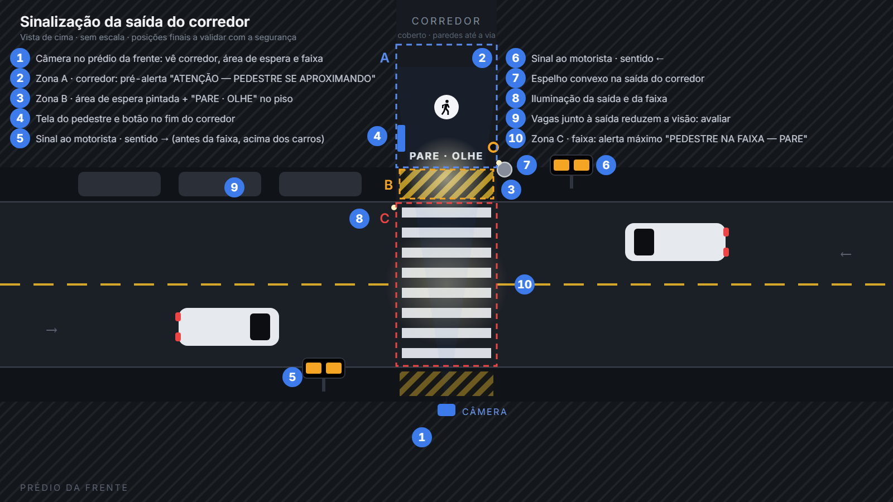

# Pit Stop na Faixa

**Sistema de visão computacional que avisa o motorista quando um pedestre vai atravessar.**
Projeto desenvolvido em equipe no **Hackathon Equatorial / EQT Lab 2026** (Desafio 3).



## O problema

Na saída de um corredor entre prédios, o pedestre chega à faixa com pouca visibilidade, e o motorista
não percebe que alguém vai atravessar. Os acidentes acontecem nesse ponto cego.

## A solução

Uma câmera acompanha o corredor, a área de espera e a faixa. Quando alguém chega e pede passagem
(parando na área marcada, levantando a mão ou apertando um botão), um **sinal de advertência acende para o motorista**,
nos dois sentidos da via. Se a pessoa já está na faixa, o alerta sobe para o nível máximo.

Tudo roda **localmente**, sem internet e sem gravar vídeo: só os eventos ficam registrados.

## Destaques técnicos

- **Visão computacional no navegador** com MediaPipe Pose Landmarker, rodando 100% offline
- **Máquina de estados determinística**, com tolerância a falhas, histerese no gesto e recuperação automática
- **Hardware:** sinal físico com ESP32/Arduino via Web Serial, com confirmação de cada comando
- **78 testes automáticos** da lógica de decisão, sem precisar de câmera (`npm test`)
- **Privacidade por design:** sem reconhecimento facial, sem gravação de vídeo, servidor só em `127.0.0.1`
- **Modo história, modo apresentação e tela do pedestre** para demonstrar o sistema sem montar a bancada

## Equipe e minha contribuição

Desenvolvi **todo o software do projeto**: a visão computacional, a máquina de estados, as telas
(painel do operador, sinal, pedestre, atividade educativa e modo história), o firmware do sinal físico,
o servidor local e os testes automáticos. O restante da equipe ficou responsável pelo **pitch** e pelo **jogo educativo**.

**Stack:** JavaScript (ES Modules) · Node.js · MediaPipe Tasks Vision · Web Serial API · BroadcastChannel · Arduino/ESP32 (C++) · HTML/CSS

> **MVP de bancada.** Webcam + computador + sinal em tela ou pequeno sinal físico. Veículos **não** são detectados.
> O sinal é uma **advertência ao motorista**, não uma autorização para o pedestre atravessar.
> Não foi testado nem é indicado para operação em trânsito real.

---

## O que está implementado

| Item (§9 P0) | Estado | Onde |
|---|---|---|
| Webcam fixa + computador | ✅ | `public/js/app.js` |
| Zonas A/B/C configuráveis e desenhadas sobre a imagem | ✅ | painel → "Zonas e configuração" |
| Presença por pose (MediaPipe Pose Landmarker Lite, local) | ✅ | `public/js/perception.js`, `interpret.js` |
| Gesto opcional (punho acima do ombro, qualquer braço, só vale em B) | ✅ | `interpret.js` → `armRaised` |
| Botão alternativo: painel, tecla **B** e botão físico no controlador | ✅ | `app.js`, firmware |
| Máquina de estados determinística, continuidade e falhas | ✅ | `public/js/controller.js` |
| Sinal em tela (contingência) com confirmação | ✅ | `public/sinal.html` |
| Sinal físico via USB serial (ESP32/Arduino), com confirmação | ✅ código · ⚠️ **não testado com placa** | `public/js/signal.js`, `firmware/` |
| Histórico local de eventos + exportação CSV | ✅ | `server.js` → `data/eventos.jsonl` |
| Atividade educativa: 3 situações + aplicação em caso novo | ✅ conteúdo **a validar com a segurança** | `public/educacao.html` |
| Funcionamento offline após o setup | ✅ verificado com rede bloqueada | — |
| Origem dos dados identificada (`webcam_bancada` / `video_teste` / `simulacao`) | ✅ | selo no topo + campo `origem` em cada evento |
| P1: vídeo de teste, métricas de latência e falsos acionamentos, multi-pessoa, export | ✅ básico | painel → métricas / revisão |
| P1: simulação de aproximação de veículo | ❌ não feito | — |

## Instalação

Requisitos: **Node.js 18+** e **Chrome ou Edge** (o Web Serial só existe nesses dois navegadores).

Na primeira vez, com internet, baixe as dependências e os modelos (eles não ficam no repositório por causa do tamanho):

```bash
npm install      # baixa @mediapipe/tasks-vision 0.10.21 (versão fixada)
npm run setup    # copia o MediaPipe para public/vendor e baixa os modelos lite (~5,8 MB) e full (~9,4 MB)
                 # opcional: npm run setup -- --heavy   (modelo heavy, ~30 MB)
```

## Execução (sem internet)

```bash
npm start
```

Abra **http://localhost:8080** no Chrome ou Edge.

- **Painel do operador:** `/`
- **Sinal em tela:** botão "Abrir sinal em tela" (abre em **janela** própria; ponha em outro monitor ou projetor)
- **Atividade educativa:** `/educacao.html`

Para testar sem internet: desligue o Wi-Fi depois do `npm run setup` e rode `npm start`. Nada é carregado de CDN.

> Se o modelo der erro ou a câmera cair logo ao iniciar (problema de GPU/WebGL no computador),
> abra o painel com **http://localhost:8080/?cpu=1** para rodar a inferência na CPU.

> ⚠️ **Não deixe o painel numa aba escondida** nem atrás de uma janela em tela cheia no mesmo monitor.
> O navegador pausa o processamento de abas ocultas, e o sistema vai (corretamente) entrar em
> FALHA por "câmera sem quadros novos". Use dois monitores, ou janelas lado a lado.

## Testes automáticos

```bash
npm test
```

São 78 testes da lógica (matriz da §15) com eventos sintéticos, sem câmera: presença em B, gesto em B e fora de B,
gesto breve, desvio em A, ocupação de C, duas pessoas, queda breve de detecção, liberação, botão, câmera congelada,
falha do sinal, tempo máximo e medição de latência.

Os testes **com pessoas reais diante da webcam** estão em [docs/testes-bancada.md](docs/testes-bancada.md). Eles ainda **não foram feitos**.

## Como usar o painel

1. **Origem:** escolha Webcam, Vídeo de teste (arquivo) ou Simulação. Clique em **Iniciar**.
2. **Zonas:** abra "Zonas e configuração", clique em "Desenhar A", marque os vértices na imagem, depois "Concluir zona".
   Repita para B e C e clique em **Salvar e aplicar configuração**.
   - A = aproximação pelo corredor · B = espera antes da faixa · C = faixa
   - Ponto de referência: `auto` usa os pés se estiverem visíveis, senão o quadril. Na bancada (webcam de frente), `quadril` costuma ser mais estável.
3. **Saída:** "Sinal em tela" (contingência) ou "Sinal físico (USB serial)" → **Conectar controlador** e escolha a porta.
4. **Revisão:** cada ativação do sinal na tabela de eventos tem os botões **✓ válida / ✗ falso acionamento**.
   Esses botões alimentam a métrica de falsos acionamentos (§14).
5. **Câmera foi movida:** coloca o sistema em FALHA até as zonas serem revisadas e salvas.
6. **Sinal: Automático / Forçar ligado / Forçar desligado:** controle do operador, sempre disponível, inclusive em falha.

### Estados (§8.4)

| Estado | Quando | Sinal |
|---|---|---|
| Observando | ninguém nas zonas | apagado |
| Aproximação | alguém em A | apagado (ou aceso, com "pré-alerta" ligado) |
| Solicitação ativa | presença em B, gesto em B ou botão | aceso por pelo menos a "advertência mínima" |
| Faixa ocupada | alguém em C | aceso enquanto houver alguém |
| Verificando liberação | a detecção sumiu depois de atividade | continua aceso por "verificação de liberação" |
| Falha | câmera sem quadros, sinal sem confirmação, tempo máximo excedido, câmera movida | **mantém** o último estado; o operador decide e clica em "Reiniciar após falha" |

Tempos padrão (demonstrativos, **não** usar em via real): confirmação de presença 300 ms · gesto 500 ms · tolerância a perda 700 ms ·
advertência mínima 8 s · verificação de liberação 2,5 s · máximo 120 s · quadro antigo 2 s · confirmação do sinal 1 s.

## Precisão da detecção (ajustes)

Ficam em **Zonas e configuração**. Cada mudança é gravada como uma nova versão da configuração.

| Ajuste | Padrão | Quando mexer |
|---|---|---|
| Modelo de pose | **full** | `lite` se o computador ficar lento (poucos quadros/s); `heavy` para máxima precisão (precisa de `npm run setup -- --heavy` e GPU boa) |
| Confiança mínima | 0,5 | baixar para 0,4 ajuda a achar duas pessoas próximas, **mas pode inventar pessoas** (aconteceu em teste) |
| Máx. pessoas | 4 | — |
| Suavização | 0,5 | mais alto = caixas e gesto mais estáveis, com um pouco mais de atraso |
| Retenção ao perder pessoa | 400 ms | mais alto se as pessoas "piscam" com frequência |

Como a estabilidade é garantida:
- **Rastreamento:** cada pessoa recebe um número temporário (sem identidade). Os pontos do corpo são suavizados entre quadros, e a pessoa é mantida por alguns instantes quando o modelo a perde. Na imagem, ela aparece com a caixa tracejada.
- **Histerese no gesto:** para iniciar, o punho precisa estar bem acima do ombro, com o antebraço para cima. Para manter, basta não descer abaixo do ombro. Um quadro duvidoso não derruba mais o gesto nem zera o tempo.

Velocidade medida no ambiente de teste (sem GPU real, câmera falsa): lite e full ≈ 80 ms/quadro, heavy ≈ 315 ms/quadro.
Num computador com GPU, os tempos tendem a ser menores. **Meçam no notebook do Demo Day** (diagnóstico → Modelo).

**Várias pessoas:** o MediaPipe Pose tem limitação com pessoas próximas ou sobrepostas. Se continuar ruim com full e heavy,
a alternativa é um modelo multipessoa, como YOLO-pose. Atenção: o YOLO da Ultralytics é **AGPL-3.0**, e o uso comercial exige licença.
Avaliar com a equipe antes de adotar.

## Operação sem operador (modo autônomo)

O sistema foi feito para funcionar sozinho. Alguém só olha quando precisa.

**Para deixar rodando:** dê dois cliques em **`iniciar.bat`**. Ele:
- sobe o servidor e o **reinicia sozinho** se ele cair;
- abre o Chrome em tela cheia em `http://localhost:8080/?auto=1`, que **liga a câmera sozinho**, mantém a tela acesa e reconecta o controlador USB usado da última vez.

Na **primeira vez**, permita a câmera e conecte o controlador manualmente (Saída → Sinal físico → Conectar). O perfil próprio do Chrome (`.chrome-quiosque/`) guarda essas permissões.
Para iniciar junto com o Windows, ponha um atalho do `iniciar.bat` em `shell:startup`. Desative também a suspensão do computador nas opções de energia.

**Recuperação automática** (regra em [public/js/autonomia.js](public/js/autonomia.js), testada em `test/autonomia.test.js`):

| Falha | O que o sistema faz sozinho |
|---|---|
| Câmera congelada ou desconectada | Reabre a câmera a cada 5 s. Quando as imagens voltam, retoma na hora. |
| Controlador USB desconectado | Reconecta a porta já autorizada a cada 5 s. |
| Sinal em tela sem confirmação | Tenta de novo. |
| Alerta aceso por mais de 120 s | Registra "revisar" e continua. O sinal segue aceso enquanto houver detecção. |
| Erro no modelo de pose | Reinicia o controle. |
| Qualquer falha que dure mais de 2 min | **Recarrega a página inteira** (só no modo autônomo). |
| "Câmera foi movida" | **Aguarda uma pessoa**: as zonas precisam ser redesenhadas. |

Regras de segurança mantidas:
- Recuperar **nunca apaga o sinal direto**. Ele só apaga depois de verificar a liberação com imagens novas.
- Toda falha e toda recuperação vão para o log (`auto_recuperacao`) e para o diagnóstico ("Autonomia").
- **Parar** manualmente não é desfeito: o modo autônomo não religa o que o operador parou.
- A recuperação pode ser desligada em Zonas e configuração → "Recuperar falhas automaticamente".

> Decisão da equipe (17/10): o documento (§8.4) sugeria suspender a automação em falha e esperar o operador.
> Como o sistema deve operar sem acompanhamento, adotamos a recuperação automática com registro para revisão.
> **Validar com a equipe de segurança** o comportamento do sinal durante a falha (hoje ele mantém o último estado).

## Modo foto — prints do sistema real para os slides

Use quando não der para demonstrar ao vivo. O sistema processa **fotos** exatamente como processaria a câmera.

1. **Tire as fotos com o celular parado no mesmo lugar** (apoiado ou num tripé), enquadrando a saída do corredor, a área de espera e a faixa.
   Sugestão de sequência: `1-chegando.jpg` (na zona A) → `2-area.jpg` (parado em B) → `3-mao.jpg` (em B com a mão levantada) → `4-faixa.jpg` (atravessando, em C).
   As fotos aparecem em ordem de nome.
2. No painel: **Fonte → Foto — imagens do celular** e escolha todas as fotos de uma vez (JPG ou PNG; fotos HEIC do iPhone precisam ser exportadas como JPG).
3. Com a primeira foto na tela, abra **Zonas e configuração** e desenhe A, B e C sobre ela (o celular não pode mudar de lugar entre as fotos). Salve.
4. Clique em **Iniciar** e depois em **Modo apresentação**. Troque de foto pelas miniaturas ou pelas teclas `←` `→`. Espere ~1 s em cada foto (os tempos de confirmação continuam valendo) e tire o print.

Cada foto vira um "quadro contínuo" para o sistema, então tudo funciona como com a câmera: detecção, zona, mão levantada, sinal ao motorista e tela do pedestre.
As fotos são reduzidas para no máximo 1280 px e respeitam a rotação do celular. O selo mostra **"FOTO · imagem estática"**, e os eventos ficam registrados com origem `foto_teste`.
Nos slides, indique que se trata de *imagem estática processada pelo protótipo*.

## Sinalização proposta para o local (planta)

Planta da saída do corredor, com câmera, dois sinais (mão dupla), área de espera pintada, tela, botão, espelho e iluminação.
Está em [docs/sinalizacao/](docs/sinalizacao/), com uma versão para slide, uma versão limpa para o jogo e o sinal em cada estado.
Para o local real, a configuração recomendada é **pré-alerta ligado** (avisa enquanto a pessoa ainda está no corredor)
e **presença na área de espera valendo como pedido**. É a mesma configuração do modo história.

## Como funciona (modo história) — para apresentar sem demonstração ao vivo

Abra **http://localhost:8080/historia.html**, ou o link "Como funciona" no topo do painel. Não precisa de câmera, de placa nem de internet.

É uma animação vista de cima da saída do corredor (a mesma planta de docs/sinalizacao), em 5 passos: ainda no corredor (pré-alerta) →
para na área e pede passagem → os dois sentidos param → atravessa → travessia concluída. Ao lado da cena aparecem **o que o motorista vê**,
**o que o pedestre vê**, a **decisão do sistema** e os **eventos registrados**.

- **Controles:** `→` próximo passo · `←` passo anterior · `espaço` reproduzir/pausar. Por padrão, a animação pausa no fim de cada passo, para o apresentador falar.
- **O que é real:** a pessoa e o carro seguem um roteiro ([public/js/historia-roteiro.js](public/js/historia-roteiro.js)), mas o estado, o sinal e a tela do pedestre
  são calculados pelo **mesmo código de decisão do sistema** (`controller.js`, `sinal-view.js`, `pedestre-view.js`). Os testes em
  `test/historia.test.js` garantem isso (por exemplo, que o carro só segue depois que o sinal apaga).
- O carro parar é a resposta do motorista no roteiro. O sistema **não detecta veículos**, e a própria tela avisa isso.
- Cabe sem rolagem em projetores 1920×1080, 1600×900 e 1366×768.

## Modo apresentação

Botão **"▶ Modo apresentação"** no topo do painel (Esc para sair). Mostra a câmera grande e, ao lado, os passos acendendo:
**Pessoa detectada → Na área de espera → Braço levantado (com barra de tempo) → Pedido registrado → Motoristas avisados**.
Embaixo aparecem as prévias do que o motorista vê e do que o pedestre vê, e o selo AO VIVO / GRAVAÇÃO / SIMULAÇÃO.
Os botões "Pedido por: ✋ Gesto / 🧍 Presença" trocam o modo na hora, e a troca fica registrada como configuração.

## Tela do pedestre (opcional)

Botão **"Abrir tela do pedestre"** no painel. É uma tela voltada para a área de espera que guia a pessoa passo a passo:

| Momento | Tela |
|---|---|
| Ninguém | **Para atravessar:** 1. Pare na área marcada · 2. Levante a mão ou aperte o botão · 3. Atravesse quando os veículos pararem |
| Chegando (zona A) | **Pare na área marcada antes da faixa** |
| Na área (zona B) | **Você está na área de espera.** Levante a mão ou aperte o botão |
| Segurando a mão | **Segure a mão levantada…** com barra de progresso |
| Pedido aceito (2,5 s) | **Pedido recebido! Motoristas avisados.** Agora olhe para os dois lados |
| Depois | **ATRAVESSE QUANDO OS VEÍCULOS PARAREM:** 👀 Olhe para os dois lados · ✋ Espere os veículos pararem · 🚶 Atravesse com os veículos parados |
| Na faixa (zona C) | **Atravessando: continue atento** |
| Falha ou sem contato | avisa que o sistema pode não estar funcionando |

A ordem é **condicionada** à parada dos veículos, que o próprio pedestre confirma olhando. O sistema não detecta veículos, então
não mostra um "ATRAVESSE" sozinho nem usa verde. Textos personalizados são verificados automaticamente: "atravesse" só é aceito
com a condição ("quando os veículos pararem" ou "com os veículos parados"), e "livre", "seguro", "siga" e "pode atravessar" são recusados.
Há um teste que garante isso.

É **opcional**: numa instalação real, a unidade decide se usa. Para desligar, desmarque
"Tela de retorno ao pedestre" em Zonas e configuração. Sem ela, o fluxo é: o motorista recebe o aviso, para,
e o pedestre atravessa depois de ver que o carro parou.

> **Futuro (não implementado):** detectar se o carro parou antes da faixa exigiria um detector de veículos,
> uma câmera na aproximação e calibração. O uso recomendado seria **medir** o comportamento ("o motorista parou?"),
> não liberar a travessia.

## Níveis do aviso ao motorista

| Nível | Quando | Sinal |
|---|---|---|
| 0 | ninguém pedindo, ninguém na faixa | apagado |
| 1 · atenção | alguém esperando ou pedindo (zona B, gesto ou botão) | âmbar, pisca lento · "ATENÇÃO — PEDESTRE" |
| 2 · alerta máximo | **alguém na faixa** (zona C), com ou sem pedido | pisca **rápido** alternando vermelho e âmbar · "**PARE — PEDESTRE NA FAIXA**" |

Quando a pessoa sai da faixa, o sinal volta ao nível 1 durante a verificação de liberação, e depois apaga.
Os textos podem ser editados em Zonas e configuração. A mudança para o nível 2 é registrada como `alerta_faixa`.
**Validar com a equipe de segurança** as cores e os textos para o uso real (padrões de sinalização da unidade e do CONTRAN).

## Sinal físico (bancada)

Firmware: [firmware/pitstop_sinal/pitstop_sinal.ino](firmware/pitstop_sinal/pitstop_sinal.ino). Grave com a Arduino IDE.

| | ESP32 | Arduino Uno/Nano |
|---|---|---|
| Lâmpada A (LED + resistor 220–330 Ω) | GPIO 25 | D9 |
| Lâmpada B (LED + resistor) | GPIO 26 | D10 |
| Botão (para o GND, pull-up interno) | GPIO 27 | D2 |
| LED de status (comunicação ok) | LED_BUILTIN | D13 |

Protocolo (115200 baud): `L1` (atenção) / `L2` (alerta máximo, pisca rápido) / `L0` / `P` → `OK L1` / `OK L2` / `OK L0` / `OK P`.
A placa envia `BTN` quando o botão é pressionado. **Firmware v2** (`HELLO pitstop v2`): uma placa com o firmware antigo não entende o `L2`, então regrave.
O painel só mostra "LIGADO (confirmado)" depois de receber o `OK`.

⚠️ Para cargas maiores que um LED de 5 mm, use transistor/MOSFET e fonte própria, montados por quem conhece o circuito.
Não ligue nada da iluminação real da instalação.

## Dados e privacidade

- São gravados **eventos**, nunca vídeo. Não há reconhecimento facial nem leitura de placas.
- `data/eventos.jsonl`: um evento por linha, com sessão, origem, versão da configuração, estado anterior e seguinte, motivo e latência.
- `data/educacao.jsonl`: respostas anônimas da atividade (perfil e momento são opcionais).
- `data/config.json`: zonas e parâmetros salvos.
- O servidor escuta só em `127.0.0.1`: nada sai da máquina.

## Limitações conhecidas (declarar na apresentação)

- **Veículos não são detectados.** A parada é uma resposta do motorista e não é medida.
- Presença depende do modelo de **pose**. Se o corpo estiver muito oculto, a pessoa pode não ser detectada. Nesse caso use o botão.
- Gesto = "punho acima do ombro por 0,5 s". Coçar a cabeça ou acenar alto pode gerar falso positivo.
- Multi-pessoa: até 3 poses. As zonas são agregadas ("alguém em C"), sem rastreamento individual.
- Sem calibração métrica: as zonas estão em pixels normalizados, não em metros.
- Ainda não houve teste com pessoas sentadas, com cadeira de rodas ou com diferentes alturas. É obrigatório antes de alegar acessibilidade.
- Em falha, o sinal **mantém** o último estado. O comportamento físico ideal em falha precisa de projeto específico.

## Estrutura

```
server.js                 servidor local (estático + eventos + config + CSV), sem dependências
scripts/setup.js          prepara o modo offline (vendor + modelo)
public/index.html         painel do operador
public/sinal.html         sinal em tela
public/pedestre.html      tela opcional do pedestre (confirma o pedido, não autoriza)
public/js/pedestre-view.js  o que a tela do pedestre mostra + guarda de textos (pura, testada)
public/educacao.html      atividade educativa
public/js/config.js       parâmetros padrão
public/js/interpret.js    pose → zona/gesto (puro, testado)
public/js/controller.js   máquina de estados (pura, testada)
public/js/signal.js       saídas: tela (BroadcastChannel) e serial (Web Serial)
public/js/perception.js   MediaPipe local
public/js/app.js          ligação de tudo + interface
public/js/log.js          fila de eventos → servidor
firmware/                 sketch do controlador de bancada
test/                     testes automáticos (node --test)
docs/testes-bancada.md    roteiro de testes manuais
```

Divisão sugerida (§17): (1) visão → `interpret.js`/`perception.js` · (2) sinal físico → `firmware/` + `signal.js` ·
(3) interface/eventos → `app.js`/`server.js` · (4) educação/acessibilidade → `educacao.*` · (5) testes e pitch → `docs/`.

## Interface (design)

- O estilo é escuro e minimalista (OLED), com linhas finas e tipografia **Inter**. A cor de marca é o azul Equatorial; âmbar e vermelho ficam só para status.
- Os tokens (cores, espaçamentos, raios) estão em [public/css/base.css](public/css/base.css) e são compartilhados por todas as telas.
- Os ícones vêm do **Lucide** (sprite local em `public/vendor/icons.svg`, gerado por `npm run setup`). Para usar um ícone novo, acrescente o nome em `ICONS` no `scripts/setup.js`.
- **Logo:** coloque o arquivo oficial em `public/assets/brand/` (veja o LEIA-ME.txt dessa pasta). Sem ele, aparece só o nome em texto.
- As recomendações de estilo, tipografia e checklist (sem emoji como ícone, contraste, foco visível, "reduzir animações") vieram da skill *ui-ux-pro-max*.
- O pictograma de pedestre do **sinal ao motorista** é próprio (estilo placa de trânsito), e o pisca dele não é desligado pela opção de "reduzir animações", porque é funcional.

## Ferramentas, bibliotecas e licenças

- [@mediapipe/tasks-vision](https://www.npmjs.com/package/@mediapipe/tasks-vision) 0.10.21 — Apache-2.0
- [lucide-static](https://lucide.dev) 1.48.0 (ícones) — ISC
- [@fontsource/inter](https://fontsource.org/fonts/inter) 5.2.8 (fonte Inter) — OFL-1.1
- Modelo Pose Landmarker Lite (float16, v1), Google — ver o model card no guia do Pose Landmarker (R8)
- Desenvolvido com apoio do Claude Code (Anthropic). Declarar conforme as regras do hackathon.
